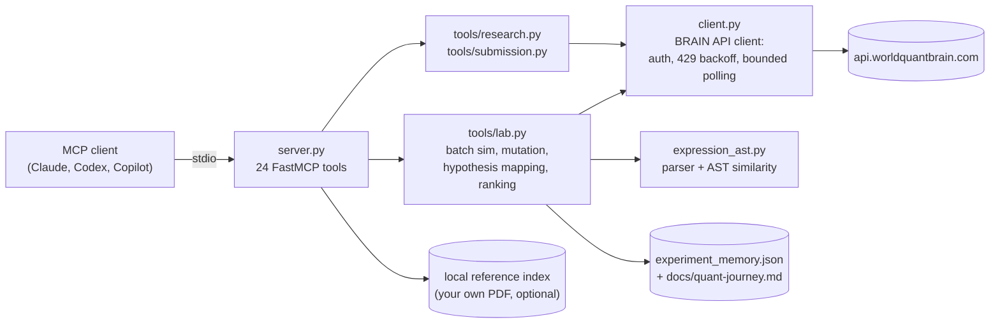

# WorldQuant BRAIN MCP

A Python [MCP](https://modelcontextprotocol.io) server that wraps the WorldQuant BRAIN API
so an AI agent (Claude, Codex, GitHub Copilot, or any MCP client) can search for alphas:
look up operators and data fields, run simulations, and check whether an alpha can be submitted.
On top of the API wrapper it has a semi-automated batch-simulation and ranking pipeline,
plus a deterministic AST-based parser for BRAIN expressions that flags near-duplicate candidates
before they use up simulation quota. I built it as a personal research-engineering project
while taking part in the WorldQuant Challenge, where the account reached **Gold Level**.

> **Note:** This is an independent, unofficial project and is not affiliated with or
> endorsed by WorldQuant. WorldQuant's platform documentation is **not** included in this
> repository: you supply your own PDF (see *Reference ingestion*). Use of the BRAIN API is
> subject to WorldQuant's own terms.

## Quick start

Requires Python 3.12+ and a WorldQuant BRAIN account.

```powershell
git clone https://github.com/duy0699cat/worldquant-brain-mcp.git
cd worldquant-brain-mcp
python -m venv .venv
.venv/Scripts/python.exe -m pip install -e .
copy .env.example .env   # then fill in WQ_BRAIN_EMAIL and WQ_BRAIN_PASSWORD
```

On macOS/Linux, use `.venv/bin/...` instead of `.venv/Scripts/...` and `cp` instead of `copy`.

Then register the server with your MCP client (below) and call `healthcheck` from the agent.
The local reference corpus is optional; without it, `healthcheck` reports `referenceChunks: 0`
and the reference-search tools return nothing.

## Status

A working personal tool, not a maintained library. It was used against the live BRAIN API
for the research logged in [`docs/quant-journey.md`](docs/quant-journey.md) (May–June 2026).

- **Works:** authentication, operator/data-field discovery, simulation submit and bounded
  polling, batch simulation with a ranked leaderboard, submission readiness checks, gated
  submission, local experiment memory, and novelty checks.
- **Limitations:**
  - No unit tests. CI ([`validate.yml`](.github/workflows/validate.yml)) only installs the
    package, compiles the sources, runs an import smoke test, and, if repository secrets are
    set, makes one live auth call.
  - Expression mutation edits strings, not the parse tree.
  - AST novelty runs in shadow mode: it is computed and reported, but the older token
    similarity still decides the ranking (see *Design notes*).
  - The `run_*_sweep.py`, `poll_self_corr.py`, `probe_api.py` and `script.py` files at the
    repo root are one-off research scripts. They are not part of the package.
  - Proprietary field IDs, alpha IDs and expressions have been redacted from the logs as
    `[REDACTED]`.

## Architecture



- **`server.py`**: defines the tools with FastMCP over stdio. `batch_simulate` is an async
  tool: it runs the blocking client calls in `asyncio.to_thread` and sends MCP progress
  notifications, one per expression.
- **`client.py`**: a synchronous `httpx` client. It authenticates once and stores the session
  token. On a 401 it re-authenticates once and retries. It retries 429s with backoff and polls
  simulations until a deadline.
- **`tools/lab.py`**: the research layer. It maps a text hypothesis to candidate data fields
  and expression templates, generates variants of a seed expression, scores novelty against
  recent alphas and logged experiments, simulates a batch and ranks the results.
  `parallel_mechanism_search` runs that whole chain for several hypothesis "branches" and
  merges their leaderboards.
- **`expression_ast.py`**: a precedence-climbing parser for BRAIN's expression language, an
  AST similarity function, and plain-English descriptions of expressions.
- **Experiment store**: `log_alpha_experiment` appends to `src/worldquant_mcp/data/experiment_memory.json`
  and to `docs/quant-journey.md`, so the next agent session can see what was already tried.

## Connecting an MCP client

The server uses stdio, so any MCP client can launch it. I have used it with Claude, Codex and
GitHub Copilot. Don't start it yourself for normal use; the client starts it.

> Paths for `.env`, the experiment store and the reference corpus are **relative to the
> working directory**, so the server should be started from the repo root.

### Claude Code

From the repo root, with credentials in `.env`:

```powershell
claude mcp add --transport stdio worldquant-mcp -- .venv/Scripts/worldquant-mcp.exe
```

### Claude Desktop

Add to `claude_desktop_config.json` (Settings → Developer → Edit Config). Claude Desktop does
not start the server in the repo folder, so this wraps the command in a `cd` (Windows example):

```json
{
  "mcpServers": {
    "worldquant-mcp": {
      "command": "cmd",
      "args": ["/c", "cd /d C:\\path\\to\\worldquant-brain-mcp && .venv\\Scripts\\worldquant-mcp.exe"],
      "env": {
        "WQ_BRAIN_EMAIL": "<your-email>",
        "WQ_BRAIN_PASSWORD": "<your-password>"
      }
    }
  }
}
```

### VS Code / GitHub Copilot

Add to your user-level `mcp.json` or the workspace `.vscode/mcp.json`:

```json
{
  "servers": {
    "worldquant-mcp": {
      "type": "stdio",
      "command": ".venv/Scripts/worldquant-mcp.exe",
      "env": {
        "WQ_BRAIN_EMAIL": "<your-email>",
        "WQ_BRAIN_PASSWORD": "<your-password>"
      }
    }
  }
}
```

Then start or reload the server from VS Code's MCP server management UI. The Copilot custom
agents in [`.github/agents/`](.github/agents/) (`quant-scout`, `quant-lab`) are set up to use these tools.

### Running it by hand (debugging only)

```powershell
.venv/Scripts/worldquant-mcp.exe
# or
.venv/Scripts/python.exe -m worldquant_mcp
```

## Tools

| Group | Tools |
|---|---|
| Account & discovery | `healthcheck`, `get_account`, `get_platform_operators`, `get_data_fields`, `get_recent_alphas`, `get_alpha` |
| Local reference | `search_local_reference`, `get_reference_operators` (plus resource `reference://worldquant/pdf`) |
| Simulation | `create_simulation`, `get_simulation`, `wait_simulation`, `batch_simulate` |
| Research pipeline | `map_research_hypothesis`, `ingest_research_material`, `mutate_alpha_expression`, `parallel_mechanism_search`, `summarize_alpha_batch_by_id` |
| Novelty & memory | `analyze_alpha_novelty`, `validate_alpha_novelty_shadow`, `log_alpha_experiment`, `list_alpha_experiments` |
| Submission | `validate_alpha_submission_by_id`, `submit_alpha_by_id` (requires `confirm=True`), `get_alpha_submission` |

## Example session

An illustrative session. The keys match what the tools return, but the values are synthetic
and the IDs are placeholders, so no real platform data is shown:

```text
> healthcheck
{ "authenticated": true, "user": { ... }, "referenceChunks": 0 }

> create_simulation  expression="rank(<your_signal>)"
{ "status_code": 201, "progress_url": "https://api.worldquantbrain.com/simulations/<sim-id>", "payload": { ... } }

> wait_simulation  simulation_id_or_url="<sim-id>"
{ "status": "COMPLETE", "alpha_id": "<id>", "alpha": { ... },
  "tracking": { "elapsed": "1m40s", "poll_count": 11, "timeout_seconds": 360, ... } }

> validate_alpha_submission_by_id  alpha_id="<id>"
{ "submittable": false,
  "metrics": { "sharpe": 1.21, "fitness": 0.74, "turnover": 0.11, ... },
  "blockingChecks": [ { "name": "LOW_FITNESS", "result": "FAIL", ... } ],
  "pendingChecks":  [ { "name": "SELF_CORRELATION", "result": "PENDING", ... } ] }
```

## Configuration

Copy `.env.example` to `.env`. All variables except the credentials are optional:

| Variable | Default | Meaning |
|---|---|---|
| `WQ_BRAIN_EMAIL`, `WQ_BRAIN_PASSWORD` | (required) | BRAIN credentials |
| `WQ_BRAIN_BASE_URL` | `https://api.worldquantbrain.com` | API base URL |
| `WQ_BRAIN_REQUEST_TIMEOUT` | `30` | Per-request HTTP timeout (s) |
| `WQ_BRAIN_POLL_INTERVAL` | `10` | Seconds between simulation polls |
| `WQ_BRAIN_MAX_POLL_SECONDS` | `180` | Client default polling deadline (used when no `timeout_seconds` is passed) |
| `WQ_BRAIN_RATE_LIMIT_MAX_RETRIES` | `6` | Retries on HTTP 429 |
| `WQ_BRAIN_RATE_LIMIT_MAX_WAIT_SECONDS` | `90` | Cap on a single backoff sleep |

The MCP tools `wait_simulation`, `batch_simulate` and `parallel_mechanism_search` pass their own
`timeout_seconds`, which defaults to **360 s per simulation**.

## Reference ingestion (optional)

`wq-ingest-reference` turns a documentation PDF that you supply into markdown and keyword-searchable
JSON chunks. It falls back to in-process OCR (`rapidocr-onnxruntime`) when the PDF has no text layer.

```powershell
wq-ingest-reference --input wq-ops.pdf
```

The output (`src/worldquant_mcp/reference/data/wq-ops.md` and `wq-ops.chunks.json`) is git-ignored,
because the source material is proprietary.

## Design notes and lessons

**Bounded polling, not open-ended waits.** Simulations can sit in BRAIN's queue for a long time.
An earlier version blocked until a simulation finished, and a research run got stuck
(the journal records restarting "the previously stuck search with bounded global polling").
Now `wait_for_simulation` polls until a deadline and then returns `status: "TIMEOUT"` with the
last payload and a tracking object (elapsed time, poll count, progress %). A timed-out simulation
is treated as *unknown*, not *bad*. In the journal, one such point was resumed later and finished normally.

**429 handling depends on the reason.** `_request` retries 429 responses up to
`WQ_BRAIN_RATE_LIMIT_MAX_RETRIES` times:
- If the server sends `Retry-After`, the client follows it, capped at the max wait.
- `CONCURRENT_SIMULATION_LIMIT_EXCEEDED` gets a slower linear backoff (15 s × attempt), because
  BRAIN can hold concurrency slots for a while.
- Anything else gets exponential backoff (2, 4, 8 … s).

Wide parallel sweeps kept hitting the concurrency limit, so `batch_simulate` submits expressions
**one at a time**. Despite its name, `parallel_mechanism_search` also processes its branches
one after another: "parallel" means several independent hypotheses in one call, not concurrent
HTTP requests.

**Novelty check: a deterministic parser instead of an LLM.** Before spending simulation quota,
`analyze_alpha_novelty` compares candidates with recent account alphas and logged experiments.
The first metric was string-based: the average of token Jaccard similarity and a `SequenceMatcher`
ratio. `expression_ast.py` adds a small hand-written parser. Its similarity score is the size of
the largest common subtree divided by the size of the smaller tree. Numeric literals match on
position, not value, so changing a lookback from 63 to 126 still counts as the same structure.
I chose a deterministic parser over an LLM judge for three reasons:
- the same input always gives the same score, so rankings can be reproduced;
- it costs nothing per call;
- it can be checked against logged expressions.

The parser also produces plain-English descriptions of expressions without any model call.

**AST scoring is still in shadow mode.** The AST score is reported next to the legacy score
(`shadowMode` in the output), and `validate_alpha_novelty_shadow` lets you compare the two on
logged experiments. Ranking still uses the legacy metric. In the journal's validation run, all
14 logged expressions parsed. Expressions from the same family scored 0.9–1.0 against each other,
and unrelated families scored about 0.1. The ranking has not been switched to the AST score yet.

**Bugs the live runs exposed, and what changed:**
- *PENDING checks treated as failures.* `validate_alpha_submission` used to block any alpha with
  a `PENDING` check. BRAIN then accepted an alpha whose `SELF_CORRELATION` was still pending,
  which showed that only `FAIL` should block. The rule was changed to match.
- *Wrong field types in hypothesis mapping.* An early microstructure search branch picked
  group-typed fields such as `currency` and produced unit errors. `lab.py` now filters candidate
  fields with allow/deny token lists.
- *Removed for the public release.* A proprietary field-alias dictionary was removed from
  `expression_ast.py` (`FIELD_ALIASES = {}`), so descriptions now show raw field names.

**Agents need a memory.** Repeated failures were often caused by agents forgetting what had
already been tried. That is why every experiment goes to both a JSON store (for tools) and a
markdown journal (for people and agents), and why the novelty check compares against that history.

## Further reading

- [`docs/quant-journey.md`](docs/quant-journey.md): the running experiment log, including failed families.
- [`docs/mcp-roadmap.md`](docs/mcp-roadmap.md): what was built and next targets (for example, mutation that edits the parse tree).
- [`docs/research-plan.md`](docs/research-plan.md): research directions that are queued.

## License

MIT. See [LICENSE](LICENSE).
